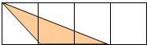

# Mathematics (Grade 6)

**ID**: 55774736
**难度**: medium_hard
**题型**: multiple_choice

## 题目
如图中阴影部分面积占整个图形面积的（  ）
$\begin{description}
\item A．\frac{2}{5}\item B．\frac{1}{4}\item C．\frac{3}{8}
\end{description}$

## 解答

**答案**: B

1. Step1:假设每个小正方形的边长为1
2. Step2:根据三角形面积公式S = 底×高÷2，计算阴影三角形面积，底为2，高为1，可得面积为2×1÷2 = 1
3. Step3:计算整个图形面积，图形为长方形，长为4，宽为1，根据长方形面积公式S = 长×宽，可得面积为4×1 = 4
4. Step4:计算阴影部分面积与整个图形面积的比值，即1÷4 = $rac{1}{4}$
5. Step5:根据选项，找出与$rac{1}{4}$对应的选项B

## 知识点

**知识点**:
  - 三角形的周长和面积．

---
