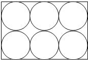

# Mathematics (Grade 6)

**ID**: 56466863
**难度**: medium_hard
**题型**: multiple_choice

## 题目
图中六个圆的半径都是4cm，那么图中长方形的面积为(  )
A．96$cm^{2}$
B．196 $cm^{2}$
C．192 $cm^{2}$
D．384 $cm^{2}$

## 解答

**答案**: D

1. Step1:根据题意，明确长方形的长等于圆的6个半径，因为圆半径是4cm，所以长方形的长为6×4 = 24cm
2. Step2:根据题意，明确长方形的宽等于圆的4个半径，因为圆半径是4cm，所以长方形的宽为4×4 = 16cm
3. Step3:根据长方形面积公式S = 长×宽，将长24cm和宽16cm代入，可得长方形面积为24×16 = 384cm²
4. Step4:对比选项，答案为D

## 知识点

**知识点**:
  - 长方形、正方形的面积．

---
