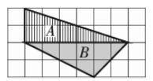

# Mathematics (Grade 6)

**ID**: 569b400a
**难度**: medium_hard
**题型**: multiple_choice

## 题目
下图的方格图中有A、B两个三角形，那么（）。
A.A的面积大
B.B的面积大
C.A和B的面积一样大

## 解答

**答案**: C

1. Step1:观察图形，发现从图形中间的一条线可知A、B两个三角形的底都是6
2. Step2:从图中观察到A、B两个三角形的高都是2
3. Step3:根据三角形面积公式，同底等高的三角形面积相等，得出A和B的面积一样大
4. Step4:对比选项，答案为C

## 知识点

**知识点**:
  - 三角形的面积

---
