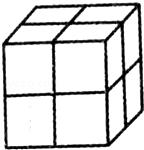

# Mathematics (Grade 6)

**ID**: 578843f0
**难度**: medium_hard
**题型**: multiple_choice

## 题目
如图是用8个同样大小的小正方体拼成的，如果任意拿走1个小正方体，它的表面积与原来相比（）

A．增加了
B．减小了
C．不变

## 解答

**答案**: C

1. Step1:观察图形可知8个小正方体拼成大图形，且每个小正方体都在顶点处
2. Step2:分析在顶点处的小正方体的外露面情况，得出每个小正方体都外露3个面
3. Step3:思考任意拿走1个小正方体后的情况，发现拿走后会外露相同的3个面
4. Step4:根据上述分析，得出拿走1个小正方体后它的表面积与原来相比不变，答案选C

## 知识点

**知识点**:
  - 小学数学;图形与几何;立体图形;组合体的表面积

---
