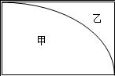

# Mathematics (Grade 6)

**ID**: 599e7589
**难度**: medium_hard
**题型**: multiple_choice

## 题目
在如图中，两块菜地的周长（  ）

A．甲比乙大
B．甲比乙小
C．甲乙同样长

## 解答

**答案**: C

1. Step1:明确甲的周长组成，为中间曲线部分与长方形的一组长宽的和
2. Step2:明确乙的周长组成，为中间曲线部分与长方形的一组长宽的和
3. Step3:由于长方形对边相等，所以甲和乙的周长相等
4. Step4:得出答案为选项C

## 知识点

**知识点**:
  - 长度比较．

---
