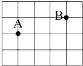

# Mathematics (Grade 6)

**ID**: 5a4b3414
**难度**: medium_hard
**题型**: multiple_choice

## 题目
如图中，如果点A的位置表示为（2，3），则点B的位置可以表示为（  ）

$\begin{description}
\item A．（4，3）\item B．（5，4）\item C．（3，4）\item D．（4，5）
\end{description}$

## 解答

**答案**: B

1. Step1:根据数对表示位置的方法，第一个数字表示列，第二个数字表示行。已知点A的位置表示为（2，3），即点A在第2列第3行。
2. Step2:观察图形，确定点B所在的列和行，点B在第5列第4行。
3. Step3:按照数对表示位置的规则，点B的位置应表示为（5，4）。
4. Step4:对比选项，发现选项B为（5，4），所以答案选B。

## 知识点

**知识点**:
  - 数对与位置．

---
