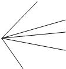

# Mathematics (Grade 6)

**ID**: 5b601912
**难度**: medium_hard
**题型**: multiple_choice

## 题目
如图中有（  ）个小于180$^{0}$的角．

$\begin{description}
\item A．5\item B．10\item C．15\item D．18
\end{description}$

## 解答

**答案**: B

1. Step1:明确题目要求是找出图中小于180°的角的个数
2. Step2:根据加法原理，先确定单个角的个数为4个
3. Step3:按照从4加到1的方式计算角的总个数，即4+3+2+1
4. Step4:计算4+3+2+1的结果为10
5. Step5:对比选项，得出答案为B

## 知识点

**知识点**:
  - 组合图形的计数．

---
