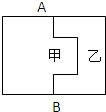

# Mathematics (Grade 6)

**ID**: 5ba45ef7
**难度**: medium_hard
**题型**: multiple_choice

## 题目
比较下面正方形中的甲乙两个图形（A、B为中点），说法正确的是（  ）
A．甲乙的面积相等，周长也相等
B．甲乙的面积相等，甲 的周长长
C．甲乙周长相等，但甲面积大
D．甲的面积大、周长长

## 解答

**答案**: C

1. Step1:根据图形可知，A、B为正方形边的中点，甲的面积大于正方形面积的$\frac{1}{2}$，乙的面积小于正方形面积的$\frac{1}{2}$，所以甲的面积大于乙的面积。
2. Step2:根据周长的意义，甲乙两个图形的周长都是由正方形的两条边和中间的曲线组成，所以甲乙周长相等。
3. Step3:综合面积和周长的比较结果，可知甲乙周长相等，但甲面积大，所以答案选C。

## 知识点

**知识点**:
  - 长方形的周长；长方形、正方形的面积．

---
