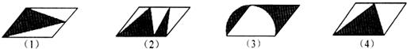

# Mathematics (Grade 6)

**ID**: 5c1e7e36
**难度**: medium_hard
**题型**: multiple_choice

## 题目
如图所示四个平行四边形完全相同，比较阴影部分的面积（  ）

A．都不相等
B．只有两个相等
C．有三个相等
D．都相等

## 解答

**答案**: D

1. Step1:分析图（1），可知其阴影部分的面积是所在平行四边形面积的一半
2. Step2:分析图（2），可知其阴影部分的面积是所在平行四边形面积的一半
3. Step3:分析图（3），可知其阴影部分的面积是所在平行四边形面积的一半
4. Step4:分析图（4），可知其阴影部分的面积是所在平行四边形面积的一半
5. Step5:由于四个平行四边形完全相同，所以四个图形中阴影部分的面积都相等，答案选D

## 知识点

**知识点**:
  - 面积及面积的大小比较．

---
