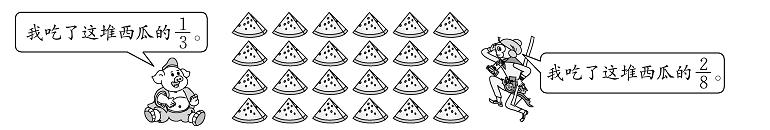

# Mathematics (Grade 6)

**ID**: 5dd61684
**难度**: medium_hard
**题型**: multiple_choice

## 题目

谁吃得多？
A：我吃了这堆西瓜的$\frac{1}{3}$。
B：我吃了这堆西瓜的$\frac{2}{8}$。

## 解答

**答案**: A

1. Step1:根据图可知一共有24块西瓜
2. Step2:计算A吃的西瓜数量，24÷3 = 8块
3. Step3:计算B吃的西瓜数量，24÷8×2 = 6块
4. Step4:比较A和B吃的西瓜数量，8＞6，得出A吃得多

## 知识点

**知识点**:
  - 

---
