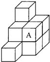

# Mathematics (Grade 6)

**ID**: 6079d992
**难度**: medium_hard
**题型**: multiple_choice

## 题目
把10个相同的小正方体按如图所示的位置堆放，它的外表含有若干个小正方形，如图将图中标有字母A的一个小正方体搬去，这时外表含有的小正方形个数与搬动前相比(  )
A．不增不减
B．减少1个
C．减少2个
D．减少3个

## 解答

**答案**: A

1. Step1:观察图形，确定搬动前小正方体A外表含有的小正方形个数为3个
2. Step2:分析搬动后A所在位置露出作为外表的小正方形个数为3个
3. Step3:对比搬动前后外表小正方形个数，因为搬动前是3个，搬动后也是3个，所以得出小正方形个数与搬动前相比不增不减，答案选A

## 知识点

**知识点**:
  - 规则立体图形的表面积．

---
