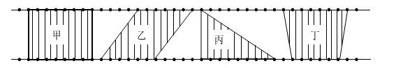

# Mathematics (Grade 6)

**ID**: 62ac8ed7
**难度**: medium_hard
**题型**: multiple_choice

## 题目
如图，两条直线互相平行，每两个点之间的距离相等，则下面叙述正确的是（）

A.丙面积最小，甲面积最大.   
B.面积按从大到小的顺序排列是甲＞乙＞丁＞丙.
C.无法比较四个图形面积的大小.  
D.甲、乙、丙、丁四个图形的面积相等.

## 解答

**答案**: A

1. Step1:因为两条直线互相平行且每两个点之间的距离相等，所以四个图形的高相等，设高为1
2. Step2:根据长方形面积公式S=长×宽，计算图形甲的面积，甲为长方形，长为7，宽为高1，所以甲的面积=7×1=7
3. Step3:根据平行四边形面积公式S=底×高，计算图形乙的面积，乙为平行四边形，底为6，高为1，所以乙的面积=6×1=6
4. Step4:根据三角形面积公式S=底×高÷2，计算图形丙的面积，丙为三角形，底为8，高为1，所以丙的面积=8×1÷2=4
5. Step5:根据梯形面积公式S=(上底+下底)×高÷2，计算图形丁的面积，丁为梯形，上底为5，下底为7，高为1，所以丁的面积=(5+7)×1÷2=6
6. Step6:比较四个图形面积大小，4＜6＜7，即丙＜乙=丁＜甲，所以丙面积最小，甲面积最大，答案选A

## 知识点

**知识点**:
  - 三角形的面积;平行四边形的面积;长方形与正方形的面积;梯形的面积

---
