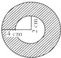

# Mathematics (Grade 6)

**ID**: 63fe2788
**难度**: medium_hard
**题型**: multiple_choice

## 题目
阴影部分的面积是$()cm^{2}$．

A．6
B．21
C．37.68

## 解答

**答案**: C

1. Step1:明确求阴影部分面积即求圆环的面积
2. Step2:根据圆环面积公式S = π(R² - r²)，其中R = 4cm，r = 2cm
3. Step3:代入数据计算3.14×(4² - 2²) = 3.14×(16 - 4)
4. Step4:继续计算3.14×(16 - 4) = 3.14×12
5. Step5:得出3.14×12 = 37.68平方厘米，所以答案选C

## 知识点

**知识点**:
  - 圆、圆环的面积．

---
