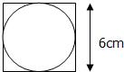

# Mathematics (Grade 6)

**ID**: 644fa87a
**难度**: medium_hard
**题型**: multiple_choice

## 题目
图中圆的面积是(  )

A．113.04平方厘米
B．28.26平方厘米
C．18.84平方厘米

## 解答

**答案**: B

1. Step1:由图可知正方形边长为6cm，根据解析2可知正方形边长即为圆的直径，所以圆的直径d = 6cm
2. Step2:根据圆的半径r = d÷2，可得圆的半径r = 6÷2 = 3cm
3. Step3:根据圆的面积公式S = πr²，这里π取3.14，所以圆的面积S = 3.14×3² = 3.14×9 = 28.26平方厘米
4. Step4:对比选项，答案是B

## 知识点

**知识点**:
  - 圆、圆环的面积．

---
