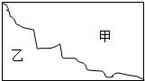

# Mathematics (Grade 6)

**ID**: 65e677cd
**难度**: medium_hard
**题型**: multiple_choice

## 题目
比较下面两个图形，说法正确的是(  )
A．甲、乙的面积相等，周长也相等
B．甲、乙的面积相等，但甲的周长长
C．甲、乙的周长相等，但甲的面积大
D．甲的面积小，周长也小

## 解答

**答案**: C

1. Step1:观察图形，发现甲的面积大于长方形面积的一半，乙的面积小于长方形面积的一半
2. Step2:根据上述面积关系，得出甲的面积大于乙的面积
3. Step3:分析甲的周长组成，为长方形的两条邻边的和+中间的曲线的长
4. Step4:分析乙的周长组成，为长方形的两条邻边的和+中间的曲线的长
5. Step5:根据甲、乙的周长组成，得出甲的周长等于乙的周长
6. Step6:结合面积和周长的比较结果，判断选项C正确

## 知识点

**知识点**:
  - 长度比较;面积及面积的大小比较．

---
