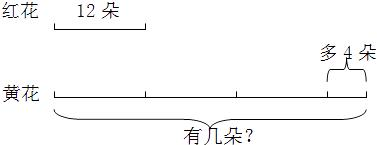

# Mathematics (Grade 6)

**ID**: 66e51b93
**难度**: medium_hard
**题型**: multiple_choice

## 题目
看图，列出正确的算式（ ） 

A．12+4
B．12×3+4
C．12×4+4
D．12÷3+4

## 解答

**答案**: B

1. Step1:观察图可知红花有12朵
2. Step2:由图得出黄花的朵数是红花的3倍多4朵
3. Step3:先计算红花数量的3倍，即12×3
4. Step4:再加上多的4朵，得到黄花数量的算式为12×3 + 4
5. Step5:对比选项，答案为B

## 知识点

**知识点**:
  - 小学数学;数与代数;应用题;复合应用题

---
