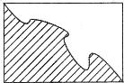

# Mathematics (Grade 6)

**ID**: 6829ff4c
**难度**: medium_hard
**题型**: multiple_choice

## 题目
如图，把一个长方形分成甲、乙两部分，它们的周长相比，（  ）

$\begin{description}
\item A．甲＞乙\item B．甲=乙\item C．甲＜乙
\end{description}$

## 解答

**答案**: B

1. Step1:明确甲的周长组成是长方形的长+宽+公共曲线边长
2. Step2:明确乙的周长组成是长方形的长+宽+公共曲线边长
3. Step3:对比甲、乙的周长组成，发现二者相同，得出甲的周长=乙的周长
4. Step4:根据选项，选择B

## 知识点

**知识点**:
  - 长度比较．

---
