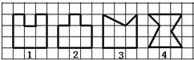

# Mathematics (Grade 6)

**ID**: 68fc89ee
**难度**: medium_hard
**题型**: multiple_choice

## 题目
图中周长最短的是（  ）号图形．

A．1
B．2
C．3
D．4

## 解答

**答案**: B

1. Step1:假设每个方格的边长为1
2. Step2:计算1号图形的周长，通过数边长可得3×4+2×1=14
3. Step3:计算2号图形的周长，根据长方形周长公式及额外边可得（3+2）×2+1×2=12
4. Step4:计算3号图形，其外轮廓为正方形时周长为3×4=12，由于内部三角形的两边之长大于第三边，所以实际周长大于12
5. Step5:计算4号图形，其外轮廓为正方形时周长为3×4=12，由于内部三角形的两边之长大于第三边，所以实际周长大于12
6. Step6:比较四个图形的周长大小，14＞12，3号和4号周长大于12，2号周长为12，得出周长最短的是2号图形

## 知识点

**知识点**:
  - 长方形的周长；长度比较．

---
