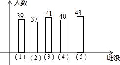

# Mathematics (Grade 6)

**ID**: 69227052
**难度**: medium_hard
**题型**: multiple_choice

## 题目
如图是某校初一年级各班的人数统计图，根据图回答该校初一总人数和初一(4)班占初一级总人数的百分数分别是
(  )
A．204和百分之五
B．200和百分之五
C．200和百分之四
D．204和百分之四
E．200和百分之二十

## 解答

**答案**: E

1. Step1:从统计图中获取初一(1)班人数为39人
2. Step2:从统计图中获取初一(2)班人数为37人
3. Step3:从统计图中获取初一(3)班人数为41人
4. Step4:从统计图中获取初一(4)班人数为40人
5. Step5:从统计图中获取初一(5)班人数为43人
6. Step6:计算初一总人数，39 + 37 + 41 + 40 + 43 = 200人
7. Step7:计算初一(4)班占初一级总人数的百分数，40÷200×100% = 20%
8. Step8:根据计算结果，判断答案为E

## 知识点

**知识点**:
  - 两种不同形式的单式条形统计图;从统计图表中获取信息．

---
