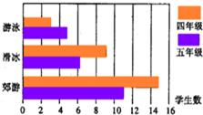

# Mathematics (Grade 6)

**ID**: 6a214aa7
**难度**: medium_hard
**题型**: multiple_choice

## 题目
下面是四、五年级的同学所喜欢的周末运动的统计图．根据图中资料，下列哪些结论是正确的？（  ）
A．参加调查的人中五年级比四年级多
B．四年级比五年级更喜欢游泳
C．四、五年级有半数以上的人喜欢郊游
D．五年级喜欢滑冰的人是四年级的2倍

## 解答

**答案**: C

1. Step1:计算四年级参加调查的人数，将喜欢游泳、滑冰、郊游的人数相加，即3 + 9 + 15 = 27人
2. Step2:计算五年级参加调查的人数，将喜欢游泳、滑冰、郊游的人数相加，即5 + 6 + 11 = 22人，比较可知四年级参加调查的人多，所以A选项错误
3. Step3:对比四年级和五年级喜欢游泳的人数，3（四年级）＜5（五年级），可知五年级比四年级更喜欢游泳，所以B选项错误
4. Step4:四年级总人数为27人，喜欢郊游的有15人，15＞27÷2；五年级总人数为22人，喜欢郊游的有11人，11 = 22÷2，可认为四、五年级喜欢郊游的人数都超过半数以上，所以C选项正确
5. Step5:五年级喜欢滑冰的有6人，四年级喜欢滑冰的有9人，6÷9≠2，所以五年级喜欢滑冰的人不是四年级的2倍，D选项错误

## 知识点

**知识点**:
  - 从统计图表中获取信息．

---
