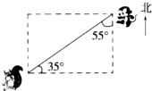

# Mathematics (Grade 6)

**ID**: 6a2742ae
**难度**: medium_hard
**题型**: multiple_choice

## 题目
以猴子为参照点，松鼠在（  ）的方向上．

A．西偏南55°
B．南偏西55°
C．东偏北55°

## 解答

**答案**: B

1. Step1:明确以猴子为参照点，需要在猴子的位置确定方向标
2. Step2:根据方向标，找出松鼠的位置
3. Step3:观察松鼠相对于猴子的方向，发现松鼠在南偏西55°的方向上
4. Step4:对比选项，得出答案为B

## 知识点

**知识点**:
  - 方向．

---
