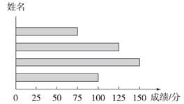

# Mathematics (Grade 6)

**ID**: 6d222c4b
**难度**: medium_hard
**题型**: multiple_choice

## 题目
下面的统计图表示的是四名同学的英语成绩，图中没有标出这四名同学的名字。已知小刚的英语成绩最好，小丽的英语成绩最差，小明比小红的英语成绩好，那么小红的英语成绩是( )分。
四名同学的英语成绩统计图

A．150
B．125
C．100
D．80

## 解答

**答案**: C

1. Step1:从统计图可知成绩从高到低对应的分数为150分、125分、100分、80分。
2. Step2:因为小刚成绩最好，所以小刚成绩是150分。
3. Step3:因为小丽成绩最差，所以小丽成绩是80分。
4. Step4:又因为小明比小红成绩好，所以小明成绩是125分，小红成绩是100分。

## 知识点

**知识点**:
  - 小学数学;统计和概率;统计;统计图;简单条形统计图

---
