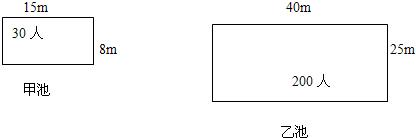

# Mathematics (Grade 6)

**ID**: 6d4aa214
**难度**: medium_hard
**题型**: multiple_choice

## 题目
比较下面两个游泳池的拥挤程度，结果是（  ）

$\begin{description}
\item A．甲池拥挤\item B．乙池拥挤\item C．两池一样\item D．无法比较
\end{description}$

## 解答

**答案**: A

1. Step1:根据长方形面积公式，计算甲池面积为15×8 = 120平方米
2. Step2:用甲池面积除以甲池人数，得到甲池每人平均活动面积为120÷30 = 4平方米
3. Step3:根据长方形面积公式，计算乙池面积为40×25 = 1000平方米
4. Step4:用乙池面积除以乙池人数，得到乙池每人平均活动面积为1000÷200 = 5平方米
5. Step5:比较甲、乙两池每人平均活动面积，4平方米＜5平方米，得出甲池拥挤

## 知识点

**知识点**:
  - 长方形、正方形的面积．

---
