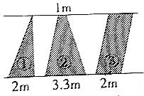

# Mathematics (Grade 6)

**ID**: 6fa04b0f
**难度**: medium_hard
**题型**: multiple_choice

## 题目
如图所示图形中面积最大的是（  ）

A．①
B．②
C．③

## 解答

**答案**: B

1. Step1:设三个图形的高都是h
2. Step2:根据三角形面积公式，计算三角形面积为2h÷2=h平方米
3. Step3:根据平行四边形面积公式，计算平行四边形面积为2h平方米
4. Step4:根据梯形面积公式，计算梯形面积为(1+3.3)h÷2=2.15h平方米
5. Step5:比较三个图形面积大小，因为2.15h＞2h＞h，所以梯形面积最大
6. Step6:得出答案为B

## 知识点

**知识点**:
  - 面积及面积的大小比较．

---
