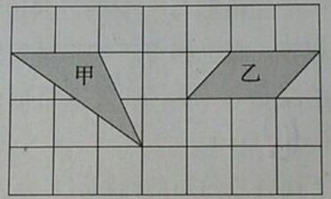

# Mathematics (Grade 6)

**ID**: 70e9c652
**难度**: medium_hard
**题型**: multiple_choice

## 题目
选择正确答案的序号填在括号里．
 下图中，两个图形的面积关系是(    )

 甲  乙
 A．甲＞乙
 B ．甲＜乙
 C．甲=乙
 D．无法确定

## 解答

**答案**: C

1. Step1:假设图中每个方格长度的单位为1
2. Step2:根据三角形面积公式底×高÷2，计算甲的面积为2×2÷2=2
3. Step3:根据平行四边形面积公式底×高，计算乙的面积为2×1=2
4. Step4:比较甲和乙的面积，因为2=2，所以得出甲=乙，答案选C

## 知识点

**知识点**:
  - --

---
