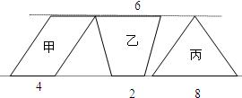

# Mathematics (Grade 6)

**ID**: 714896b5
**难度**: medium_hard
**题型**: multiple_choice

## 题目
如图，图甲是平行四边形，h列说法正确了是（  ）（单位：厘米）
$\begin{description}
\item A．甲、乙、丙三个图形面积相等\item B．甲、乙、丙三个图形面积不相等\item C．只有甲和乙两个图形面积相等
\end{description}$

## 解答

**答案**: A

1. Step1:根据夹在两条平行线之间的垂线段处处相等，可知甲、乙、丙三个图形的高相等，设高为h厘米。
2. Step2:根据平行四边形面积公式S = 底×高，计算甲的面积为4×h = 4h平方厘米。
3. Step3:根据梯形面积公式S=(上底 + 下底)×高÷2，计算乙的面积为(6 + 2)×h÷2 = 4h平方厘米。
4. Step4:根据三角形面积公式S = 底×高÷2，计算丙的面积为8×h÷2 = 4h平方厘米。
5. Step5:比较甲、乙、丙的面积，发现甲、乙、丙三个图形面积均为4h平方厘米，所以甲、乙、丙三个图形面积相等。

## 知识点

**知识点**:
  - 面积及面积的大小比较．

---
