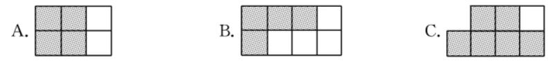

# Mathematics (Grade 6)

**ID**: 71c490fa
**难度**: medium_hard
**题型**: multiple_choice

## 题目
如图表示3块花圃，阴影部分种玫瑰花，种玫瑰花的面积占百分比最大的是（）

## 解答

**答案**: C

1. Step1:计算A选项中种玫瑰花的面积占比，整块花圃平均分成3份，阴影部分占2份，所以占比为$\frac{2}{6}=\frac{1}{3}$，转化为百分数约为33.3%
2. Step2:计算B选项中种玫瑰花的面积占比，整块花圃平均分成8份，阴影部分占4份，所以占比为$\frac{4}{8}=50\%$
3. Step3:计算C选项中种玫瑰花的面积占比，整块花圃可看作平均分成7份，阴影部分占6份，所以占比为$\frac{6}{7}\approx85.7\%$
4. Step4:比较三个选项的占比大小，85.7%＞50%＞33.3%
5. Step5:得出种玫瑰花面积占百分比最大的是C选项

## 知识点

**知识点**:
  - 小数、分数和百分数的互化;分数的意义

---
