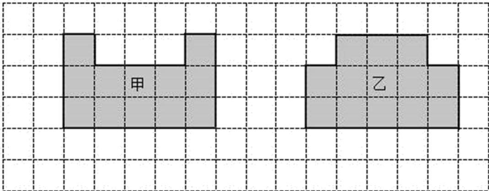

# Mathematics (Grade 6)

**ID**: 71dd6664
**难度**: medium_hard
**题型**: multiple_choice

## 题目
下面两个图形的周长相比较，结果是（    ）。 

$\begin{description}
\item A.甲＞乙\item B.甲＜乙\item C.甲＝乙
\end{description}$

## 解答

**答案**: A

1. Step1:明确甲图形周长的组成，其等于长为5格、宽为3格的长方形周长加中间竖着的两条小线段的长度之和
2. Step2:明确乙图形周长的组成，其等于长为5格、宽为3格的长方形周长
3. Step3:对比甲、乙图形周长的组成，由于甲比乙多了中间竖着的两条小线段的长度，所以甲的周长大于乙的周长
4. Step4:根据选项，选择答案A

## 知识点

**知识点**:
  - 

---
