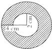

# Mathematics (Grade 6)

**ID**: 71f9df70
**难度**: medium_hard
**题型**: multiple_choice

## 题目
阴影部分的面积是（  ）cm$^{2}$．

A．6
B．21
C．37.68

## 解答

**答案**: C

1. Step1:明确阴影部分是圆环，求圆环面积用公式S=π（R² - r²），其中R为大圆半径，r为小圆半径
2. Step2:由图可知大圆半径R = 4cm，小圆半径r = 2cm
3. Step3:将R = 4cm，r = 2cm代入公式S=π（R² - r²），得到S = 3.14×（4² - 2²）
4. Step4:先计算括号内4² - 2² = 16 - 4 = 12
5. Step5:再计算3.14×12 = 37.68（平方厘米）
6. Step6:对比选项，得出答案为C

## 知识点

**知识点**:
  - 圆、圆环的面积．

---
