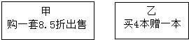

# Mathematics (Grade 6)

**ID**: 74dc7e02
**难度**: medium_hard
**题型**: multiple_choice

## 题目

(2012•宿迁)一套《小学生十万个为什么》共15本，每本单价相同“六一”期间，甲乙两书店出售这套书采用不同的促销方法：(  )个书店便宜．
A．一样
B．甲
C．乙

## 解答

**答案**: C

1. Step1:设每本的单价是1
2. Step2:计算甲商店购买一套书的价格，先求出一套书（15本）的原价为15×1 = 15，再根据8.5折销售，即现价是原价的85%，得到现价为15×85% = 12.75
3. Step3:分析乙商店的促销方式，买4本赠1本，一套15本，15÷(4 + 1)=3，即赠送3本，只需付15 - 3 = 12本的钱，其价格为12×1 = 12
4. Step4:比较甲乙两商店的价格，12.75＞12，得出乙商店便宜，答案选C

## 知识点

**知识点**:
  - 百分数的实际应用．

---
