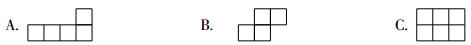

# Mathematics (Grade 6)

**ID**: 7680a57c
**难度**: medium_hard
**题型**: multiple_choice

## 题目
用边长1厘米的小正方形拼成下面的图形，周长最长的是（ ）。

## 解答

**答案**: A

1. Step1:根据周长定义，计算图形A的周长，将其看作长4厘米、宽1厘米的长方形周长加两条边的和，即(4+1)×2+1×2=12厘米
2. Step2:计算图形B的周长，将其看作两条长2厘米的线段和6条1厘米的线段之和，即2×2+1×6=10厘米
3. Step3:计算图形C的周长，将其看作长3厘米、宽2厘米的长方形的周长，即(3+2)×2=10厘米
4. Step4:比较三个图形的周长大小，12＞10，得出周长最长的是A

## 知识点

**知识点**:
  - 长方形与正方形的周长;周长的认识

---
