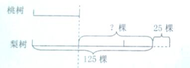

# Mathematics (Grade 6)

**ID**: 76a48961
**难度**: medium_hard
**题型**: multiple_choice

## 题目
根据下面的线段图选择正确的算式（  ）

$\begin{description}
\item A．125+（125-25）÷3\item B．125-（125-25）÷3\item C．125-（125+25）÷3\item D．125+（125+25）÷3
\end{description}$

## 解答

**答案**: C

1. Step1:根据线段图可知梨树有125棵，且梨树的棵数比桃树棵数的3倍少25棵，所以先求桃树棵数的3倍，为125 + 25棵
2. Step2:再求桃树的棵数，桃树棵数的3倍是125 + 25棵，那么桃树棵数为(125 + 25)÷3棵
3. Step3:最后求梨树比桃树多的棵数，梨树有125棵，桃树有(125 + 25)÷3棵，所以梨树比桃树多125 - (125 + 25)÷3棵，对应的算式是选项C

## 知识点

**知识点**:
  - 图文应用题．

---
