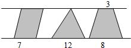

# Mathematics (Grade 6)

**ID**: 76f86010
**难度**: medium_hard
**题型**: multiple_choice

## 题目
如图中三个阴影部分的面积相比，(  )最大．

A．平行四边形
B．三角形
C．梯形

## 解答

**答案**: A

1. Step1:设三角形、平行四边形、梯形的高都为h
2. Step2:根据三角形面积公式，计算三角形面积为12×h÷2 = 6h
3. Step3:根据平行四边形面积公式，计算平行四边形面积为7×h = 7h
4. Step4:根据梯形面积公式，计算梯形面积为(3 + 8)×h÷2 = 5.5h
5. Step5:比较三个图形面积大小，7h＞6h＞5.5h
6. Step6:得出平行四边形面积最大，答案为A

## 知识点

**知识点**:
  - 面积及面积的大小比较．

---
