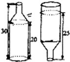

# Mathematics (Grade 6)

**ID**: 76fb338c
**难度**: medium_hard
**题型**: multiple_choice

## 题目

(2013•东莞)如果要测量一个瓶子的容积，测得瓶子的底面直径为10厘米，然后给瓶子内盛入一些水，正放时水高20厘米，倒放时水高25厘米，瓶子深30厘米．那么这个瓶子的容积是$厘米^{3}$．
A．500π
B．625π
C．750π
D．2500π

## 解答

**答案**: B

1. Step1:计算瓶子倒放时空余部分的高度，30 - 25 = 5厘米
2. Step2:得出瓶子容积相当于高度为水的高度加上倒放时空余部分高度的圆柱的体积，20 + 5 = 25厘米
3. Step3:根据圆柱体积公式V = Sh = π×(r²)×h，计算瓶子容积，其中r = 10÷2 = 5厘米，h = 25厘米，即π×(10÷2)²×25 = π×25×25 = 625π立方厘米

## 知识点

**知识点**:
  - 关于圆柱的应用题．

---
