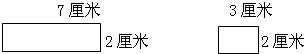

# Mathematics (Grade 6)

**ID**: 772d3a5c
**难度**: medium_hard
**题型**: multiple_choice

## 题目
下图分别是一个长方体的前面和右面，那么这个长方体的底面积是(  )

A．14平方厘米
B．6平方厘米
C．21平方厘米

## 解答

**答案**: C

1. Step1:根据长方体前面可知长方体的长是7厘米，高是2厘米
2. Step2:根据长方体右面可知长方体的宽是3厘米，高是2厘米
3. Step3:由前面和右面可确定长方体底面的长是7厘米，宽是3厘米
4. Step4:根据长方形面积公式s = ab（其中a为长，b为宽），可得底面积为7×3 = 21平方厘米
5. Step5:所以答案选C

## 知识点

**知识点**:
  - 长方体和正方体的表面积．

---
