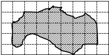

# Mathematics (Grade 6)

**ID**: 7735627b
**难度**: medium_hard
**题型**: multiple_choice

## 题目
图中一个小正方形的面积表示1平方厘米，请你估一估阴影部分面积大约是（  ）平方厘米．
$\begin{description}
\item A．10\item B．15\item C．20\item D．30
\end{description}$

## 解答

**答案**: C

1. Step1:观察图形，估计阴影部分的长大约为7厘米
2. Step2:观察图形，估计阴影部分的宽大约为3厘米
3. Step3:根据长方形面积公式，计算阴影部分面积大约为7×3 = 21平方厘米
4. Step4:对比选项中的数值，找出最接近21平方厘米的选项，C选项20最接近，所以答案是C

## 知识点

**知识点**:
  - 数的估算；长方形、正方形的面积．

---
