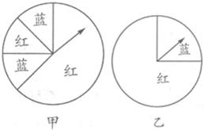

# Mathematics (Grade 6)

**ID**: 77f0a393
**难度**: medium_hard
**题型**: multiple_choice

## 题目
指针转动后，停在蓝色区域上的可能性（  ）大．
A．转盘甲
B．转盘乙
C．两个转盘一样

## 解答

**答案**: C

1. Step1:分析转盘甲，将其看成整体“1”，发现它被平均分成8份，蓝色区域占2份，所以指针停在蓝色区域的可能性为2÷8 = $\frac{2}{8}$ = $\frac{1}{4}$
2. Step2:分析转盘乙，将其看成整体“1”，发现它被平均分成4份，蓝色区域占1份，所以指针停在蓝色区域的可能性为1÷4 = $\frac{1}{4}$
3. Step3:比较两个转盘指针停在蓝色区域的可能性，发现都是$\frac{1}{4}$，所以两个转盘停在蓝色区域的可能性一样，答案选C

## 知识点

**知识点**:
  - 可能性的大小．

---
