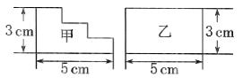

# Mathematics (Grade 6)

**ID**: 78be8761
**难度**: medium_hard
**题型**: multiple_choice

## 题目
如下图，甲、乙两个图形的周长相比（   ）．

A．甲比乙长
B．乙比甲长
C．一样长
D．不能确定

## 解答

**答案**: C

1. Step1:将甲图形右上方的小线段分别向上平移、向右平移
2. Step2:此时甲图形的周长转化为长5厘米、宽3厘米的长方形的周长，根据长方形周长公式C=(a + b)×2（其中a为长，b为宽），可得甲图周长为(5 + 3)×2 = 16厘米
3. Step3:乙图形本身就是长5厘米、宽3厘米的长方形，根据长方形周长公式可得乙图周长为(5 + 3)×2 = 16厘米
4. Step4:比较甲、乙图形的周长，16厘米 = 16厘米，所以甲、乙两个图形的周长一样长，答案选C

## 知识点

**知识点**:
  - 

---
