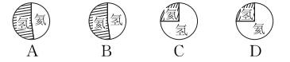

# Mathematics (Grade 6)

**ID**: 78f36057
**难度**: medium_hard
**题型**: multiple_choice

## 题目
太阳主要是由75%的氢和25%的氦组成的。下面（）能正确地表示这个信息。

## 解答

**答案**: C

1. Step1:把太阳看作单位'1'，用一个圆表示
2. Step2:将氢所占比例75%化为分数$\frac{3}{4}$
3. Step3:将氦所占比例25%化为分数$\frac{1}{4}$
4. Step4:分析选项，看哪个选项是把圆平均分成4份，氦占1份（即$\frac{1}{4}$，25%），氢占3份（即$\frac{3}{4}$，75%）
5. Step5:得出答案C能正确表示该信息

## 知识点

**知识点**:
  - 扇形统计图

---
