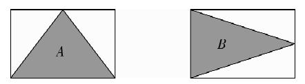

# Mathematics (Grade 6)

**ID**: 7a228454
**难度**: medium_hard
**题型**: multiple_choice

## 题目
下面两个长方形完全相同， 阴影部分的面积（）。

A.$S_{A}$＞$S_{B}$
B.$S_{A}$=$S_{B}$
C.$S_{A}$＜$S_{B}$
D.无法比较

## 解答

**答案**: B

1. Step1:明确图A中三角形，其底是长方形的长，高是长方形的宽，根据三角形面积公式S = 底×高÷2，可得图A面积 = 长×宽÷2
2. Step2:明确图B中三角形，其底是长方形的宽，高是长方形的长，根据三角形面积公式S = 底×高÷2，可得图B面积 = 长×宽÷2
3. Step3:因为两个长方形完全相同，即长和宽分别相等，所以图A面积和图B面积都等于同一个长方形面积的一半，故$S_{A}$=$S_{B}$
4. Step4:对比选项，答案是B

## 知识点

**知识点**:
  - 三角形的面积

---
