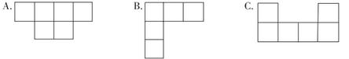

# Mathematics (Grade 6)

**ID**: 7ac5d5eb
**难度**: medium_hard
**题型**: multiple_choice

## 题目
下列三个图形中，每个小正方形都一样大，那么（）图形的周长最长。

## 解答

**答案**: C

1. Step1:设小正方形边长为1，对于A图形，将其看作长为4，宽为2的长方形，根据长方形周长公式C=(a + b)×2（其中a为长，b为宽），可得其周长为(4 + 2)×2 = 12
2. Step2:对于B图形，将其看作边长为3的正方形，根据正方形周长公式C = 4a（其中a为边长），可得其周长为3×4 = 12
3. Step3:对于C图形，先将其看作长为4，宽为2的长方形，其周长为(4 + 2)×2，再加上上面中间多出的2个边长，即(4 + 2)×2 + 2 = 12 + 2 = 14
4. Step4:比较三个图形周长大小，14＞12，所以C图形周长最长

## 知识点

**知识点**:
  - 巧算周长(奥数)

---
