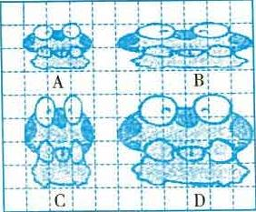

# Mathematics (Grade 6)

**ID**: 7adf02c9
**难度**: medium_hard
**题型**: multiple_choice

## 题目
右图中，图形（    ）最像图形A．

## 解答

**答案**: D

1. Step1:分析图B，发现其与图A相比高度没变，宽度变化，所以图B与图A不相似，不符合题意
2. Step2:分析图C，发现其与图A相比宽度没变，高度变化，所以图C与图A不相似，不符合题意
3. Step3:计算图A最宽处与最高处的比为3:2
4. Step4:计算图D最宽处与最高处的比为3:2，与图A的比例相等，所以图D符合题意

## 知识点

**知识点**:
  - 比的认识
--

---
