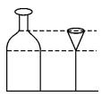

# Mathematics (Grade 6)

**ID**: 7b0aef8c
**难度**: medium_hard
**题型**: multiple_choice

## 题目
如图，酒瓶中装有一些酒，倒进一只酒杯中，酒杯的直径是酒瓶的一半，瓶中酒的高度与酒杯的高度比为5:2.共能倒满（）

A.10杯
B.15杯
C.20杯
D.30杯

## 解答

**答案**: D

1. Step1:设酒杯的半径是r，高是h
2. Step2:根据圆锥体积公式，计算酒杯的容积为$\frac{1}{3}$πr$^{2}$h
3. Step3:因为酒杯的直径是酒瓶的一半，瓶中酒的高度与酒杯的高度比为5:2，所以酒瓶的半径为2r，酒的高度为2.5h
4. Step4:根据圆柱体积公式，计算酒瓶中酒的体积为π(2r$^{2}$×2.5h=10πr$^{2}$h
5. Step5:用酒瓶中酒的体积除以酒杯的容积，即10πr$^{2}$h÷$\frac{1}{3}$πr$^{2}$h，得出能倒满的杯数为30杯

## 知识点

**知识点**:
  - 圆锥的体积;圆柱的体积

---
