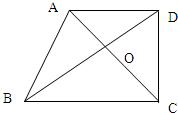

# Mathematics (Grade 6)

**ID**: 7b35694b
**难度**: medium_hard
**题型**: multiple_choice

## 题目
如图，梯形ABCD中，比较三角形ABO与三角形DCO的面积(  )

A．三角形ABO面积大
B．三角形DCO面积大
C．一样大
D．无法比较

## 解答

**答案**: C

1. Step1:观察图形，发现△ABC和△DBC同底等高
2. Step2:根据同底等高的三角形面积相等，得出S_{△ABC}=S_{△DBC}
3. Step3:因为S_{△ABC}=S_{△AOB}+S_{△BOC}，S_{△DBC}=S_{△DOC}+S_{△BOC}，所以S_{△AOB}+S_{△BOC}=S_{△DOC}+S_{△BOC}
4. Step4:等式两边同时减去S_{△BOC}，得到S_{△AOB}=S_{△DOC}，即三角形ABO与三角形DCO的面积相等

## 知识点

**知识点**:
  - 面积及面积的大小比较．

---
