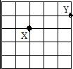

# Mathematics (Grade 6)

**ID**: 7dbed952
**难度**: medium_hard
**题型**: multiple_choice

## 题目
如图：如果点X的位置表示为（2，3），则点Y的位置可以表示为（  ）

A．（4，4）
B．（4，5）
C．（5，4）
D．（3，3）

## 解答

**答案**: C

1. Step1:根据点X的位置（2，3），确定2代表第2列，3代表第3行
2. Step2:观察图形，确定点Y在第5列
3. Step3:观察图形，确定点Y在第4行
4. Step4:根据数对表示位置的方法，列在前，行在后，得出点Y的位置用数对表示为（5，4）
5. Step5:对比选项，选择C

## 知识点

**知识点**:
  - 数对与位置．

---
