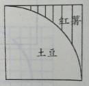

# Mathematics (Grade 6)

**ID**: 7dcda339
**难度**: medium_hard
**题型**: multiple_choice

## 题目
农场有一个块正方形菜地，如图所示，这两部分的周长相比，(    )。

 红薯 土豆
 A.种土豆的部分的周长大
 B.种红薯的部分的周长大
 C.一样大

## 解答

**答案**: C

1. Step1:明确任务是比较种土豆部分和种红薯部分的周长大小
2. Step2:观察图形，确定种土豆部分的周长是由正方形的两条边以及同一1/4圆的弧长组成
3. Step3:观察图形，确定种红薯部分的周长是由正方形的两条边以及同一1/4圆的弧长组成
4. Step4:对比两部分周长的组成，发现它们的组成相同，所以得出两部分周长一样大的结论，答案选C

## 知识点

**知识点**:
  - --

---
