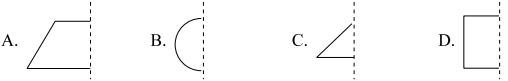

# Mathematics (Grade 6)

**ID**: 7f5eafb1
**难度**: medium_hard
**题型**: multiple_choice

## 题目
下列图形绕虚线旋转一周可得到圆柱的是（）。

## 解答

**答案**: D

1. Step1:明确题目要求是找出绕虚线旋转一周可得到圆柱的图形
2. Step2:分析选项A，根据旋转性质可知其中图形旋转一周后得到圆台，不符合要求
3. Step3:分析选项B，根据旋转性质可知其中图形旋转一周后得到球，不符合要求
4. Step4:分析选项C，根据旋转性质可知其中图形旋转一周后得到圆锥，不符合要求
5. Step5:分析选项D，根据旋转性质可知其中图形旋转一周后得到圆柱，符合要求
6. Step6:得出答案为D

## 知识点

**知识点**:
  - 旋转;圆柱的认识

---
