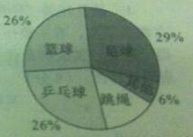

# Mathematics (Grade 6)

**ID**: 7f74d38d
**难度**: medium_hard
**题型**: multiple_choice

## 题目
如图是六（4）班同学喜欢的运动项目统计图，从图中可以看出，喜欢跳绳的人占全体同学的（    ）．
$A.\,\frac{1}{4}$
$B.\,15\%$
$C.\,13\%$
$D.\,无法确定$

 篮球26%    足球29%
 乒乓球26%   其他6%

## 解答

**答案**: C

1. Step1:明确饼状图中所有项目占比总和为100%
2. Step2:已知喜欢篮球的人占比26%，喜欢足球的人占比29%，喜欢乒乓球的人占比26%，其他项目占比6%
3. Step3:用100%依次减去篮球、足球、乒乓球和其他项目的占比，即1 - 26% - 26% - 29% - 6%
4. Step4:先计算1 - 26% - 26% = 48%
5. Step5:再计算48% - 29% = 19%
6. Step6:最后计算19% - 6% = 13%，得出喜欢跳绳的人占全体同学的13%

## 知识点

**知识点**:
  - --

---
