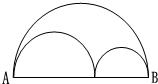

# Mathematics (Grade 6)

**ID**: 8001082b
**难度**: medium_hard
**题型**: multiple_choice

## 题目
如图，甲乙二人同时同速从A地出发，分别沿外边的大半圆和里边的两个小半圆跑到B地，谁先跑到终点？（  ）
$\begin{description}
\item A．甲\item B．乙\item C．同时
\end{description}$

## 解答

**答案**: C

1. Step1:设最小的半圆的直径为d，则较大一点的半圆的直径为2d，最大的半圆的直径为3d
2. Step2:根据圆的周长公式C = πd（C为周长，d为直径），计算甲跑的长度，甲沿大半圆跑，其长度为π×3d÷2 = 1.5πd
3. Step3:计算乙跑的长度，乙沿两个小半圆跑，长度为π×d÷2 + π×2d÷2 = 0.5πd + πd = 1.5πd
4. Step4:比较甲和乙跑的长度，1.5πd = 1.5πd，两人跑的长度一样
5. Step5:因为甲乙二人同时同速出发，且跑的长度一样，所以两人同时到达终点，答案选C

## 知识点

**知识点**:
  - 圆、圆环的周长．

---
