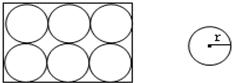

# Mathematics (Grade 6)

**ID**: 804591f4
**难度**: medium_hard
**题型**: multiple_choice

## 题目
下图中的六个圆大小一样，若半径是r，则长方形的面积为(  )
A．6$r^{2}$
B．24$r^{2}$
C．12$r^{2}$

## 解答

**答案**: B

1. Step1:计算圆的直径，因为圆的半径是r，所以直径为2r
2. Step2:计算长方形的长，长方形的长等于3个圆的直径，即3×2r = 6r
3. Step3:计算长方形的宽，长方形的宽等于2个圆的直径，即2×2r = 4r
4. Step4:根据长方形面积公式S = ab（a为长，b为宽），计算长方形面积为6r×4r = 24r²
5. Step5:对比选项，答案为B

## 知识点

**知识点**:
  - 长方形、正方形的面积．

---
